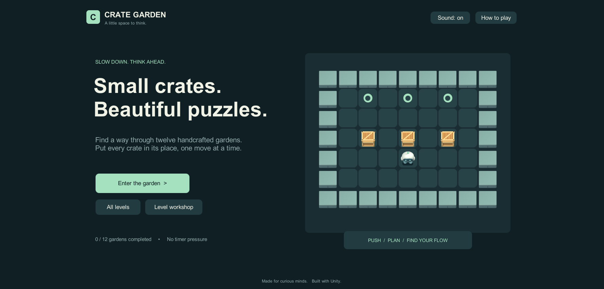
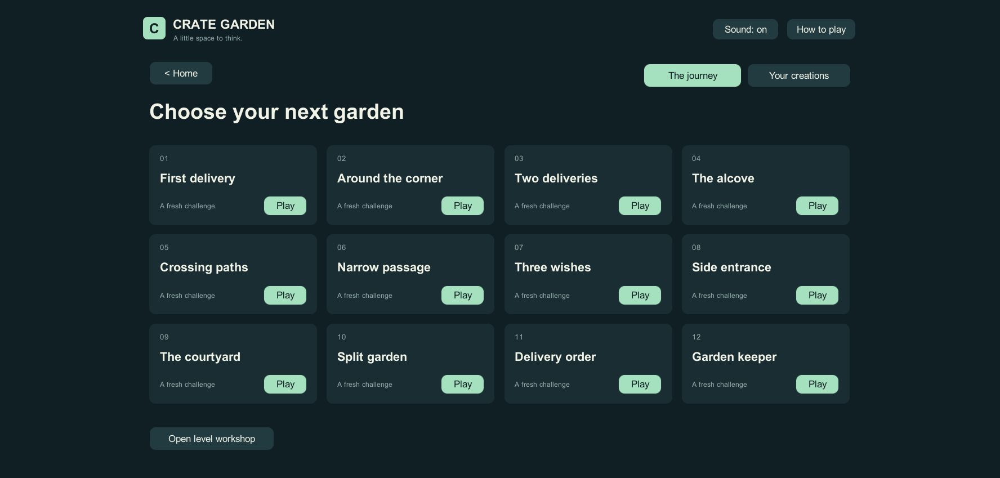
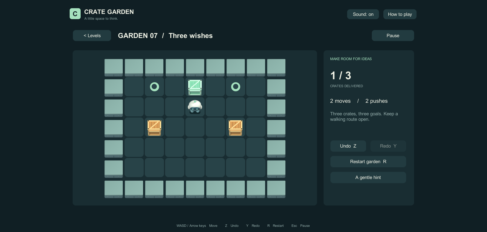
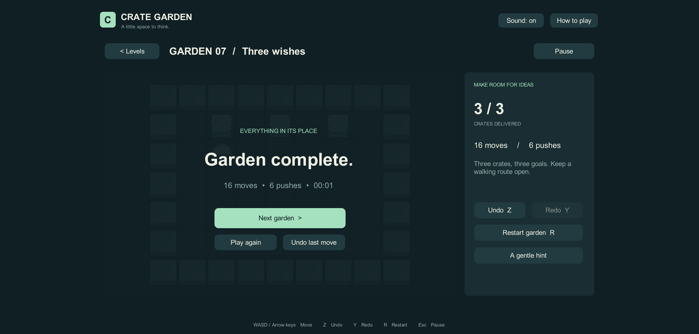
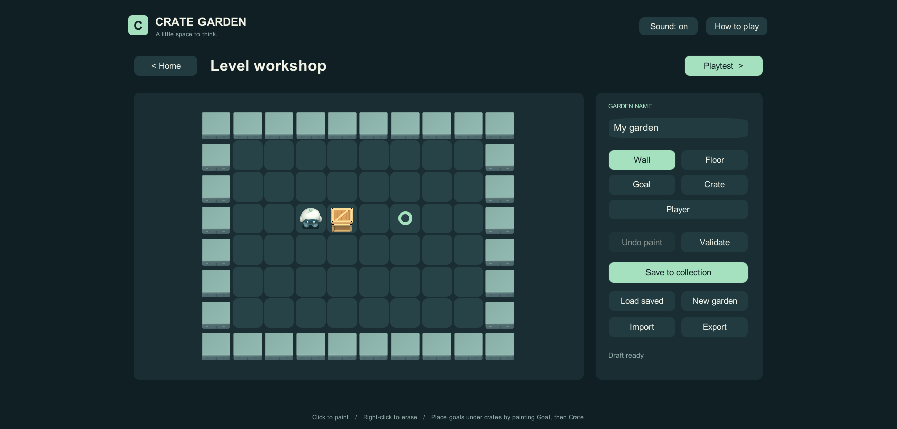

# Crate Garden · 箱庭推箱子

**把每一只箱子，送到它该去的地方。**

Crate Garden 是一款使用 **Unity 2022.3** 制作的桌面推箱子游戏。玩家操控小机器人，在十二座小花园中规划路线，将木箱推到目标位置；也可以打开游戏内的关卡编辑器，设计、试玩并分享自己的谜题。

项目包含完整的游玩流程、原创 Blender 美术源文件、运行时关卡编辑器，以及可重复执行的规则与存档测试。

[新手游戏教程](Docs/GAME_GUIDE.md) · [游玩流程与实机截图](#游玩流程与实机截图) · [测试报告](Docs/TEST_RESULTS.md) · [验收记录](Docs/ACCEPTANCE.md) · [构建结果](Docs/BUILD_RESULT.md)

## 项目概览

| 项目 | 说明 |
| --- | --- |
| 引擎 | Unity 2022.3.62f3c1，当前实际验证版本 |
| 类型 | 俯视棋盘 / 推箱子 / 单人解谜 |
| 内容 | 12 个原创关卡 + 游戏内关卡编辑器 |
| 操作 | 桌面键盘与鼠标 |
| 美术 | Blender 原创建模，透明贴图渲染，搭配程序绘制界面 |
| 已验证平台 | macOS |
| 交付内容 | Unity 工程、资源及 `.meta`、Blender 模型、渲染脚本、中文文档 |

## 获取与运行

```sh
git clone https://github.com/jifeng-2025/crate-garden.git
```

1. 在 Unity Hub 中添加仓库内的 **`My project`** 文件夹，而不是仓库根目录。
2. 使用 **Unity 2022.3.62f3c1** 打开，等待 Package Manager 还原依赖并完成资源导入。
3. 打开 `Assets/Scenes/CrateGarden.unity`，点击 Unity 顶部的 **Play**。
4. 在主菜单点击 **Enter the garden** 开始；已有通关进度时，按钮显示为 **Continue journey**。

工程使用 Unity 2022.3 LTS 系列；其他补丁版本（包括 2022.3.51f1）未单独实测。首次打开需要联网还原 Unity 包依赖；游戏本身可以离线游玩，运行和构建不要求 Blender 或 MCP 服务在线。

本地构建输出为 `Builds/Crate Garden.app`。GitHub 仓库提供源码，不包含该应用或 Unity 缓存；从仓库获取工程后，可按下文自行构建。

## 游戏规则与操作

目标是将**所有木箱推到薄荷绿色圆环上**。机器人每次移动一格，只能推动前方的一只箱子，不能拉箱子，也不能同时推动两只箱子。箱子到达目标后变为绿色，全部就位后进入结算。

| 按键 / 入口 | 功能 |
| --- | --- |
| `WASD` / 方向键 | 移动与推箱；支持长按连续移动 |
| `Z` / Undo | 撤销上一步，通关后也可撤销 |
| `Y` / Redo | 重做已撤销的动作；走出新分支后清空重做历史 |
| `R` / Restart garden | 重新开始当前关卡 |
| `Esc` / Pause | 暂停；编辑器试玩时按 `Esc` 返回编辑器 |
| A gentle hint | 根据当前局面尝试求解，提供下一步方向 |
| Sound: on / off | 切换音效，设置会保存 |

墙角是最常见的陷阱：如果箱子被推到没有目标的死角，就无法再推出。游戏会提示这类局面，可以用撤销调整路线。提示系统设有搜索预算，复杂局面可能只给出通用建议，不保证识别所有死锁。

## 新手教程：先完成前两关

1. 主菜单点击 **All levels**，选择 **01 · First delivery**。从初始位置按 **→、→**，两次推动即可通关。
2. 通关后按 **Z** 撤销最后一步，再按 **Y** 重做，熟悉操作容错。
3. 进入 **02 · Around the corner**，从初始位置按 **↑、←、↑、→、→**：先向上推，再绕到箱子左侧向右推。
4. 后续关卡先规划机器人的绕行空间，避免把箱子推入没有目标的墙角；需要时使用 **A gentle hint**。

完整的 [游戏教程](Docs/GAME_GUIDE.md) 包含棋盘识别、逐步走法、撤销练习、卡关处理、存档说明，以及从绘制到保存、分享的关卡编辑器教学。

## 已实现功能

- **完整关卡流程**：主菜单、继续游戏、自由选关、游玩、通关结算、下一关。
- **十二个原创谜题**：从单箱直推与转向，到双箱、多箱和障碍布局；全部经求解和动作回放验证。
- **操作反馈**：平滑移动、推箱音效、完成状态配色、步数、推箱次数和目标计数。
- **容错与辅助**：撤销、重做、重开、暂停、角落死锁提示和局面提示。
- **持久化**：完成进度、最佳成绩、音效设置、自制关卡；原子保存与备份恢复。
- **内置编辑器**：绘制、撤销绘制、校验、命名、保存、加载、试玩、JSON 导入导出。

## 关卡编辑器

从主菜单进入 **Level workshop**，选择右侧笔刷，在棋盘中绘制。

| 功能 | 用法 |
| --- | --- |
| Wall / Floor / Goal / Crate / Player | 放置墙、地板、目标、箱子或机器人 |
| 左键 / 右键 | 绘制 / 清空格子；外边框保持为墙 |
| Undo paint | 撤销一次绘制 |
| Validate | 检查结构，并在搜索预算内尝试验证可解性 |
| Playtest | 试玩当前草稿；返回后保留编辑内容，不计入正式成绩 |
| Save to collection | 保存到选关页的 **Your creations** 收藏 |
| Load saved / New garden | 加载已有作品 / 新建画布 |
| Export / Import | 复制或粘贴 JSON，分享与导入关卡 |

新画布为 **10×8**；导入支持宽 **3–20**、高 **3–16** 的矩形棋盘。每行必须等宽、外边框封闭、恰好一个玩家，箱子与目标数量相同且至少一对。目标上再放箱子或玩家，会保留底层目标。

JSON 字符约定：`#` 墙，空格地板，`.` 目标，`$` 箱子，`@` 玩家，`*` 目标上的箱子，`+` 目标上的玩家。

保存已有作品时，修改布局会清除该关卡的旧成绩，仅重命名则保留成绩。导入生成新 ID，不覆盖已有收藏。离开或新建未保存草稿时有确认；加载和导入界面也会提示替换当前草稿。

## 工程结构与美术来源

```text
crate-garden/
├── My project/
│   ├── Assets/Scenes/CrateGarden.unity       # 游戏入口
│   ├── Assets/Sokoban/Runtime/              # 规则、界面、编辑器、存档
│   ├── Assets/Sokoban/Editor/               # 构建、验收、贴图导入工具
│   ├── Assets/Sokoban/Resources/GardenArt/  # Blender 渲染贴图
│   ├── Packages/                           # Unity 依赖与 MCP 编辑器插件
│   └── ProjectSettings/                    # 工程与构建配置
├── ArtSource/GardenAssets.blend            # 原创美术源模型
├── Tools/build_garden_art.py               # 可复现的建模与渲染脚本
└── Docs/                                   # 验收、测试、截图及第三方说明
```

`Puzzle.cs` 提供不依赖 Unity 的确定性棋盘规则、历史栈、死角检测与 BFS 求解。`CrateGardenGame.cs` 负责状态流程、输入、界面和运行时编辑器；`SaveStore.cs` 负责 JSON 数据与持久化。

木箱、绿色完成箱、石墙和机器人由 Blender 原创建模，使用倒角、材质与柔光渲染成四张 **256×256 RGBA** 贴图。Unity 关闭这些贴图的有损压缩和 mipmap，减少小尺寸透明边缘杂色。地面、目标环和界面由程序绘制，音效由正弦波合成。

需要重新生成美术时，可在仓库根目录运行：

```sh
blender --background --python Tools/build_garden_art.py
```

脚本从自身位置定位仓库，创建独立美术场景，不删除已有场景。授权与依赖见 [第三方说明](Docs/THIRD_PARTY.md)。

## 测试与构建

当前验证结果：**202 项自动断言通过，12 个关卡全部可解，Play 模式回归通过，macOS 构建 0 错误、0 警告。**

Unity 顶部 **Crate Garden** 菜单提供以下工具：

| 菜单 | 用途 |
| --- | --- |
| Run Acceptance Tests | 规则、全关卡求解回放、存档备份、JSON 和贴图加载验证 |
| Smoke Test Play Mode | Play 模式下验证通关、草稿恢复、试玩保留编辑及初始已完成关卡 |
| Build macOS | 生成 `Builds/Crate Garden.app`，写入构建报告 |
| Prepare Main Scene | 重建入口场景和构建配置；会替换当前打开场景，使用前保存自己的修改 |

构建 macOS 应用时，先退出 Play 模式，确认 Unity 已安装 macOS 构建支持，再选择 **Crate Garden → Build macOS**。输出位置为仓库根目录下的 `Builds/Crate Garden.app`，可在 Finder 中打开；本仓库没有附带预编译应用下载。

报告：[自动测试](Docs/TEST_RESULTS.md) · [Play 模式回归](Docs/PLAYMODE_RESULTS.md) · [验收记录](Docs/ACCEPTANCE.md) · [构建结果](Docs/BUILD_RESULT.md)。

## 存档与当前边界

存档位于 `Application.persistentDataPath`。macOS 通常为 `~/Library/Application Support/Garden Studio/Crate Garden/`，包含 `progress.json`、`levels.json` 和备份 `.bak`。编辑器与独立应用共用产品目录。退出或重开会重新开始当前局，已完成进度和最佳成绩保留。**Continue journey** 会进入第一个尚未完成的内置关卡，不会恢复上次的中途棋盘；十二关全部完成后会从第一关重新开始。

最佳成绩优先比较步数：步数更少时更新；步数相同则选择推箱次数更少的记录。用时只用于结算展示，不参与最佳成绩排名。

当前为**英文游戏界面、中文说明文档**，面向桌面键鼠。没有触屏、手柄或移动平台支持；Windows、Linux 未实机验收。最佳成绩与自制关卡保存在本地，没有云同步。`Library`、`Temp`、日志、构建产物和个人存档均不上传仓库。

## 游玩流程与实机截图

以下图片均来自 **Unity Play 模式下的实际游戏画面**，使用仓库中的 Blender 美术资源。截图按流程演示，采用独立演示存档；通过自动调用游戏移动逻辑完成关卡，未修改棋盘计数或拼接界面。结算中的短用时来自自动回放，不代表人工游玩速度。

### 1. 进入箱庭

启动后进入主菜单。第一次游玩选择 **Enter the garden**；之后可以通过 **Continue journey** 进入尚未完成的关卡。也可以从这里进入所有关卡或关卡编辑器。



### 2. 选择一个谜题

点击 **All levels** 查看十二个内置关卡。所有关卡均可自由选择，适合按顺序学习，也方便反复挑战。完成后，卡片会记录通关状态与最佳步数；自制关卡位于 **Your creations**。



### 3. 规划路线，把箱子送到目标

以第七关 **Three wishes** 为例：先观察三个目标、三个箱子以及机器人可以绕行的位置。图中机器人已经向上推动中间的箱子两次，将它送到目标上；箱子变绿，右侧计数更新为 **1 / 3**，同时记录 **2 moves / 2 pushes**。

接下来需要绕到其他箱子后方，再逐一送达。若推错方向，可以撤销；不确定如何继续时，可以请求提示。



### 4. 完成关卡，继续下一座花园

所有箱子都到达目标后，游戏显示 **Garden complete**，列出本局步数、推箱次数和用时。可以进入下一关、重玩，或撤销最后一步重新思考。正式游玩的完成状态和最佳成绩会保存到本地。



### 5. 设计并试玩自己的关卡

返回主菜单，打开 **Level workshop**。用笔刷摆放墙、目标、箱子和机器人，点击 **Validate** 检查结构与可解性，再通过 **Playtest** 亲自试玩。满意后保存到收藏，也可以导出 JSON 分享给其他玩家。


